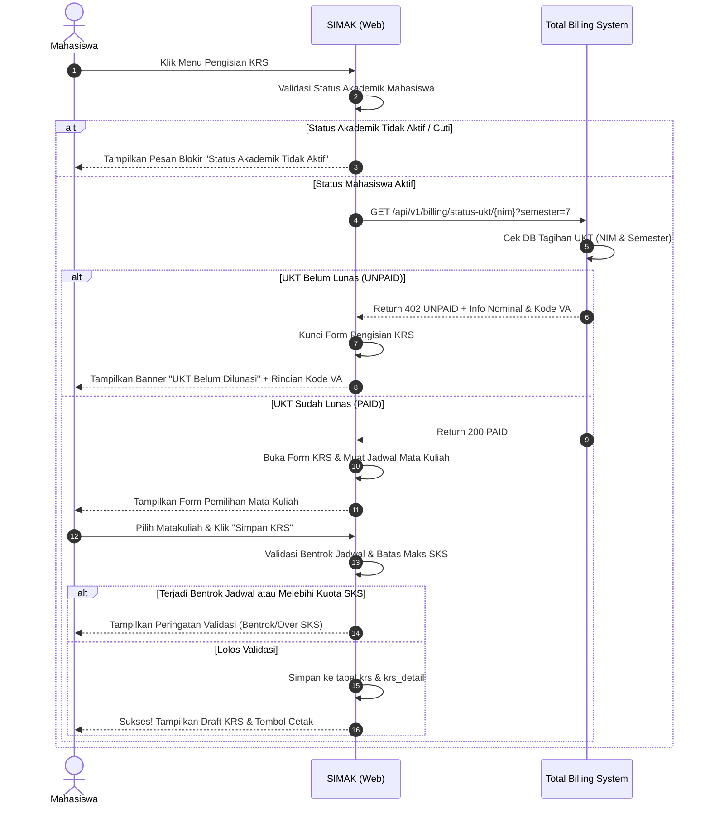
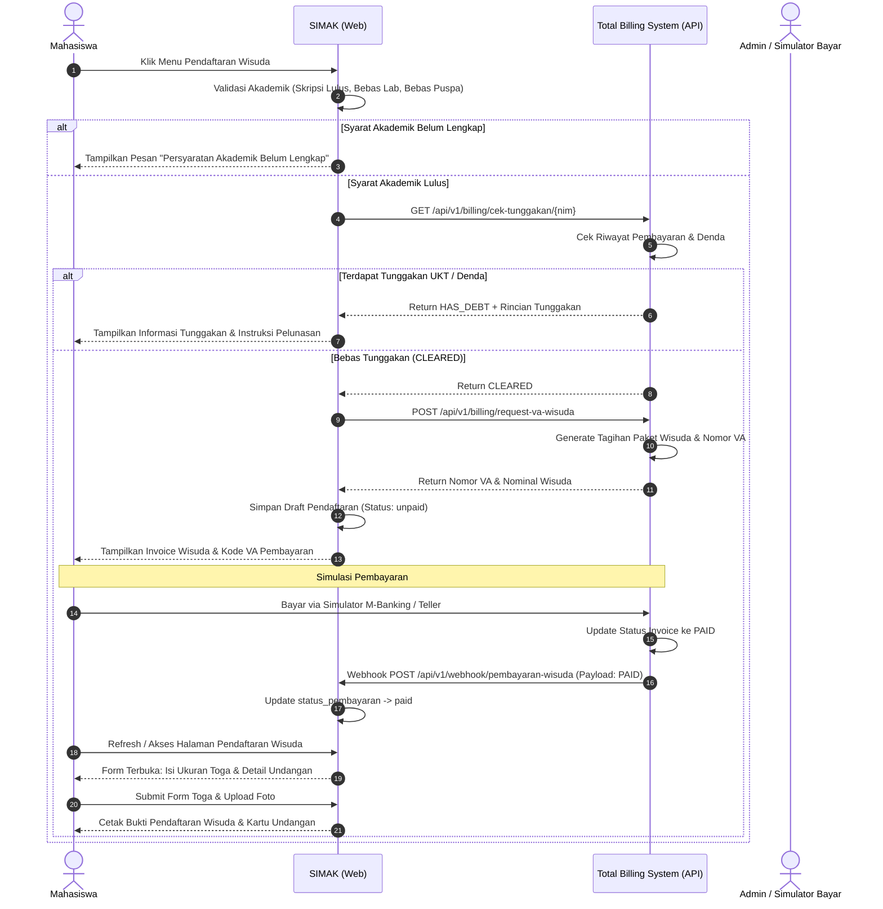

# DOKUMEN SPESIFIKASI ARSITEKTUR & RENCANA PENGEMBANGAN INTEGRASI EAI
## SISTEM INFORMASI AKADEMIK (SIMAK) & TOTAL BILLING SYSTEM

Dokumen ini memuat arsitektur sistem, spesifikasi komunikasi data, perancangan basis data, integrasi API & Webhook, alur bisnis sesuai use case dan activity diagram, serta roadmap implementasi bertahap untuk mata kuliah Enterprise Application Integration (EAI).

---

## 1. IKHTISAR SISTEM DAN ARSITEKTUR INTEGRASI

Sistem ini mengimplementasikan konsep Enterprise Application Integration (EAI) menggunakan arsitektur Point-to-Point REST API dikombinasikan dengan Asynchronous Webhook Callback:

1. **Aplikasi SIMAK (Sistem Informasi Akademik)**:
   - Berfungsi sebagai core operasional akademik mahasiswa dan dosen.
   - Mengelola master mahasiswa, kurikulum mata kuliah, pengisian KRS, validasi akademik skripsi, dan verifikasi akhir wisuda.
   - Berperan sebagai **API Client** saat meminta status UKT & tagihan wisuda ke Total Billing System.
   - Berperan sebagai **Webhook Receiver** saat menerima notifikasi pelunasan wisuda dari Billing System.

2. **Aplikasi Total Billing System**:
   - Berfungsi sebagai sentral penagihan finansial kampus.
   - Mengelola data invoice UKT semesteran, denda keterlambatan, dan penerbitan Virtual Account (VA) paket wisuda.
   - Menyediakan Payment Simulator (simulasi bayar perbankan) agar proses pengujian pembayaran dapat dilakukan mandiri tanpa gateway bank nyata.
   - Berperan sebagai **API Provider** untuk verifikasi status tagihan.
   - Berperan sebagai **Webhook Dispatcher** yang memancarkan event `payment.success` secara real-time ke SIMAK.

---

## 2. MEKANISME KOMUNIKASI DATA (EAI DESIGN)

Komunikasi antar dua aplikasi menggunakan standar RESTful JSON over HTTP dengan skema keamanan shared secret token (`X-API-KEY` dan `X-Signature-HMAC`).

### A. Pola Komunikasi Sinkron (Synchronous API Request)
Digunakan saat SIMAK membutuhkan validasi cepat sebelum mengizinkan mahasiswa melanjutkan aksi pada antarmuka.

1. **Pengecekan Status UKT Mahasiswa**:
   - **Trigger**: Mahasiswa mengakses menu "Pengisian KRS".
   - **Method / Endpoint**: `GET http://localhost:8001/api/v1/billing/status-ukt/{nim}?semester={semester}`
   - **Header**: `Authorization: Bearer <BILLING_API_KEY>`, `Accept: application/json`
   - **Payload Response (Lunas)**:
     ```json
     {
       "status": "success",
       "code": 200,
       "data": {
         "nim": "210101001",
         "semester": "7",
         "status_ukt": "PAID",
         "nomor_invoice": "INV-UKT-2026-7-001",
         "nominal": 4500000,
         "tanggal_bayar": "2026-08-10 14:22:00"
       }
     }
     ```
   - **Payload Response (Belum Lunas)**:
     ```json
     {
       "status": "unpaid",
       "code": 402,
       "data": {
         "nim": "210101001",
         "semester": "7",
         "status_ukt": "UNPAID",
         "nomor_invoice": "INV-UKT-2026-7-001",
         "nominal": 4500000,
         "nomor_va": "8808210101001001",
         "jatuh_tempo": "2026-09-01 23:59:59"
       }
     }
     ```

2. **Pengecekan Bebas Tunggakan UKT & Denda (Pra-Wisuda)**:
   - **Trigger**: Mahasiswa mengakses menu "Pendaftaran Wisuda" (setelah lolos syarat lulus skripsi & bebas lab/puspa).
   - **Method / Endpoint**: `GET http://localhost:8001/api/v1/billing/cek-tunggakan/{nim}`
   - **Payload Response (Bersih / Cleared)**:
     ```json
     {
       "status": "success",
       "has_debt": false,
       "total_tunggakan": 0,
       "detail": []
     }
     ```
   - **Payload Response (Ada Tunggakan / HAS_DEBT)**:
     ```json
     {
       "status": "has_debt",
       "has_debt": true,
       "total_tunggakan": 1500000,
       "detail": [
         { "jenis": "DENDA_KRS", "semester": "6", "nominal": 250000 },
         { "jenis": "UKT_KURANG_BAYAR", "semester": "6", "nominal": 1250000 }
       ]
     }
     ```

3. **Penerbitan Invoice & Virtual Account Wisuda**:
   - **Trigger**: SIMAK meminta kode bayar wisuda setelah verifikasi bebas tunggakan.
   - **Method / Endpoint**: `POST http://localhost:8001/api/v1/billing/request-va-wisuda`
   - **Request Body**:
     ```json
     {
       "nim": "210101001",
       "nama": "Dzulfikri Alifajri",
       "prodi": "Teknik Informatika",
       "periode_wisuda": "2026/2"
     }
     ```
   - **Payload Response**:
     ```json
     {
       "status": "created",
       "data": {
         "invoice_wisuda_id": "INV-WSD-2026-0042",
         "nomor_va": "9901210101001",
         "nominal": 1750000,
         "kadaluarsa": "2026-11-01 23:59:59"
       }
     }
     ```

---

### B. Pola Komunikasi Asinkron (Webhook Event-Driven Callback)
Digunakan ketika mahasiswa membayar invoice wisuda di simulator Billing System. SIMAK akan menerima update instan tanpa perlu polling berulang.

1. **Callback Status Pembayaran**:
   - **Event Trigger**: Verifikasi pembayaran di Total Billing System.
   - **Method / Target**: `POST http://localhost:8000/api/v1/webhook/pembayaran-wisuda`
   - **Header**:
     - `X-Billing-Signature: sha256_hmac_hash`
     - `Content-Type: application/json`
   - **Payload Body**:
     ```json
     {
       "event": "payment.success",
       "timestamp": "2026-10-14T17:00:00Z",
       "data": {
         "nim": "210101001",
         "invoice_id": "INV-WSD-2026-0042",
         "nomor_va": "9901210101001",
         "jenis_tagihan": "WISUDA",
         "nominal_dibayar": 1750000,
         "status": "PAID",
         "waktu_transaksi": "2026-10-14 16:59:45"
       }
     }
     ```
   - **Tindakan di SIMAK**:
     - Membuka form lanjutan pendaftaran wisuda (ukuran toga, jumlah undangan, upload pas foto wisuda).
     - Mengubah status pendaftaran wisuda menjadi siap diverifikasi admin/cetak bukti pendaftaran.

---

## 3. PERANCANGAN BASIS DATA & STRUKTUR TABEL

Untuk mematuhi prinsip integrasi independen (loose coupling) EAI, kedua aplikasi memiliki database terpisah di MySQL Laragon:

### A. Database SIMAK (`db_simak`)

1. **Tabel `users`**:
   - `id`: BigInt (PK)
   - `username`: Varchar(50) (NIM untuk mahasiswa, NIP/Username untuk Admin)
   - `password`: Varchar(255)
   - `role`: Enum('admin', 'mahasiswa')
   - `created_at`, `updated_at`

2. **Tabel `mahasiswa`**:
   - `nim`: Varchar(20) (PK)
   - `nama`: Varchar(150)
   - `program_studi`: Varchar(100)
   - `fakultas`: Varchar(100)
   - `angkatan`: Varchar(4)
   - `status_akademik`: Enum('aktif', 'cuti', 'non_aktif')
   - `status_skripsi`: Enum('belum', 'seminar_proposal', 'sidang', 'lulus')
   - `bebas_lab`: Boolean (Default: false)
   - `bebas_perpustakaan`: Boolean (Default: false)
   - `ips_lalu`: Decimal(3,2) (Untuk batas maksimal SKS)

3. **Tabel `mata_kuliah`**:
   - `kode_mk`: Varchar(20) (PK)
   - `nama_mk`: Varchar(150)
   - `sks`: SmallInt
   - `semester`: Varchar(2)
   - `hari`: Varchar(10) (Senin - Sabtu)
   - `jam_mulai`: Time
   - `jam_selesai`: Time
   - `ruangan`: Varchar(50)
   - `kuota`: SmallInt

4. **Tabel `krs`**:
   - `id`: BigInt (PK)
   - `nim`: Varchar(20) (FK -> `mahasiswa.nim`)
   - `semester`: Varchar(2)
   - `tahun_akademik`: Varchar(9) (e.g. "2026/2027")
   - `total_sks`: SmallInt
   - `status_krs`: Enum('draft', 'disetujui')
   - `created_at`, `updated_at`

5. **Tabel `krs_detail`**:
   - `id`: BigInt (PK)
   - `krs_id`: BigInt (FK -> `krs.id`)
   - `kode_mk`: Varchar(20) (FK -> `mata_kuliah.kode_mk`)

6. **Tabel `pendaftaran_wisuda`**:
   - `id`: BigInt (PK)
   - `nim`: Varchar(20) (FK -> `mahasiswa.nim`)
   - `tanggal_daftar`: Date
   - `invoice_id`: Varchar(50) (Diperoleh dari Billing)
   - `nomor_va`: Varchar(50) (Diperoleh dari Billing)
   - `status_pembayaran`: Enum('unpaid', 'paid')
   - `status_pendaftaran`: Enum('menunggu_pembayaran', 'berkas_lengkap', 'disetujui')
   - `ukuran_toga`: Enum('S', 'M', 'L', 'XL', 'XXL') Nullable
   - `jumlah_undangan`: SmallInt Nullable
   - `file_foto`: Varchar(255) Nullable
   - `created_at`, `updated_at`

---

### B. Database Total Billing System (`db_billing`)

1. **Tabel `users`**:
   - `id`: BigInt (PK)
   - `name`: Varchar(100)
   - `email`: Varchar(100) Unique
   - `password`: Varchar(255)
   - `role`: Enum('admin_keuangan', 'teller')

2. **Tabel `mahasiswa_ref`**:
   - `nim`: Varchar(20) (PK)
   - `nama`: Varchar(150)
   - `prodi`: Varchar(100)
   - `angkatan`: Varchar(4)

3. **Tabel `tagihan_pembayaran`**:
   - `id`: BigInt (PK)
   - `nomor_invoice`: Varchar(50) Unique
   - `nim`: Varchar(20)
   - `jenis_tagihan`: Enum('UKT', 'WISUDA', 'DENDA')
   - `semester`: Varchar(2)
   - `jumlah_tagihan`: Decimal(12,2)
   - `nomor_va`: Varchar(30) Unique
   - `status_pembayaran`: Enum('UNPAID', 'PAID', 'EXPIRED')
   - `tanggal_jatuh_tempo`: DateTime
   - `tanggal_bayar`: DateTime Nullable
   - `channel_bayar`: Varchar(50) Nullable (e.g., 'M-BANKING SIMULATOR')
   - `created_at`, `updated_at`

4. **Tabel `log_webhook_event`**:
   - `id`: BigInt (PK)
   - `event_name`: Varchar(50)
   - `target_url`: Varchar(255)
   - `payload`: Text
   - `response_code`: SmallInt
   - `is_success`: Boolean
   - `created_at`: DateTime

---

## 4. ALUR PROSES BISNIS SISTEM

### A. Alur Pengisian KRS Mahasiswa


### B. Alur Pendaftaran Wisuda & Pelunasan Asinkron


---

## 5. STANDAR DESAIN DAN ANTISLOP UI GUIDELINES

Sesuai permintaan instruksi dan plugin Antislop:
1. **Modern, Simple, and Clean**:
   - Tidak menggunakan template AI generik (tidak ada gradien ungu-biru neon, tidak ada glassmorphism berlebihan).
   - Tipografi rapi menggunakan Google Fonts (e.g. Plus Jakarta Sans atau Inter) dengan kontras yang lolos standar WCAG AA (>= 4.5:1).
   - Konsistensi tema dan palet warna:
     - SIMAK: Slate / Royal Navy (akademik terstruktur dan berwibawa).
     - Total Billing System: Slate / Emerald Teal (finansial, audit, ketepatan transaksi).
2. **Three Mandatory UI States**:
   - **Empty State**: Ilustrasi data bersih dan instruktif saat belum ada jadwal/tagihan.
   - **Loading State**: Skeleton/spinner halus saat panggilan API integrasi berlangsung.
   - **Error State**: Banner informatif dan tombol *Retry* jika service Billing tidak dapat dijangkau (Network Timeout handling).
3. **Pemberdayaan Tombol Nyata**:
   - Semua tombol dan link memiliki aksi nyata; tidak ada elemen hiasan pasif.
   - Simulator M-Banking di Total Billing System memiliki feedback instan satu-klik untuk mempermudah demonstrasi presentasi kuliah EAI.

---

## 6. RENCANA KERJA TAHAP DEMI TAHAP (ACTION PLAN)

- **Fase 1: Setup Lingkungan & Inisialisasi Proyek (Laravel 13 Monorepo Berdampingan)**
  - Folder `simak/` (Port 8000) dan `billing/` (Port 8001).
  - Setup database `db_simak` dan `db_billing` di MySQL Laragon.
- **Fase 2: Pemodelan Data & Seeder**
  - Migrasi skema database untuk kedua aplikasi.
  - Seeder data mahasiswa, dosen/admin, mata kuliah, jadwal kuliah, dan skenario tagihan UKT (mahasiswa lunas vs menunggak, skripsi lulus vs belum).
- **Fase 3: Implementasi Backend API & Integrasi EAI**
  - Pembuatan Controller API di Total Billing System.
  - Pembuatan Service Integrasi HTTP Client di SIMAK dengan Guzzle/Http facade.
  - Implementasi Webhook Dispatcher & Receiver dengan verifikasi signature.
- **Fase 4: Antarmuka Mahasiswa & Admin (Frontend Blade + Clean Modern CSS)**
  - Tampilan Dashboard SIMAK (Mahasiswa & Admin).
  - Form KRS interaktif dengan validasi SKS & bentrok jadwal.
  - Halaman Pendaftaran Wisuda & cetak bukti pendaftaran.
  - Tampilan Dashboard Total Billing System dengan Payment Simulator.
- **Fase 5: Validasi Pengujian Skenario & Review Akhir**
  - Pengujian skenario KRS mahasiswa belum lunas UKT vs sudah lunas.
  - Pengujian skenario wisuda belum lulus skripsi vs ada tunggakan vs berhasil bayar melalui simulator.
